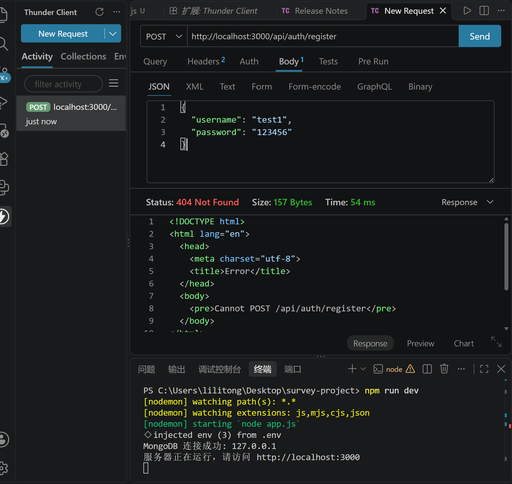

# AI 使用日志 (ai-log.md)

### 记录 1：初始化 Node.js + Express + MongoDB 项目结构

- **日期**：2026-10-15
- **工具**：ChatGPT
- **我的提示词（Prompt）**："请帮我写一个 Node.js + Express 连接 MongoDB 的初始代码，需要一个主入口文件和一个 db 配置文件。"
- **AI 给出的回复**：
  AI 给出了一套简洁、可直接运行的初始项目代码，包含主入口文件 `app.js` 和数据库配置文件 `db.js`，使用 `mongoose` 连接 MongoDB，并在连接成功后启动 Express 服务。
- **我的修改和发现**：
  1. AI 不仅给出了基础代码，还提出了一个非常重要的优化：**先连接数据库，成功后再启动服务器**。
  2. 修改 `config/db.js`：把错误处理交给主程序去捕获。
  3. 修改 `app.js`：使用了 `startServer` 函数，确保数据库连上后，才启动 Web 服务器。这让我理解了服务启动的先后顺序对稳定性的影响。

---

### 记录 2：编写并完善用户数据模型 User.js

- **日期**：2026-10-16
- **工具**：ChatGPT
- **我的提示词（Prompt）**：
  "我正在用 Node.js + Express + MongoDB (Mongoose) 开发一个问卷系统。请帮我用 Mongoose 编写 models/User.js 模型代码。要求：1. 字段包括：用户名 (username，唯一)、密码 (password)、注册时间 (created_at，默认当前时间)。2. 包含密码加密的中间件（使用 bcryptjs），在保存前对密码进行哈希加密。3. 包含一个实例方法 matchPassword，用于登录时对比输入的密码和数据库中的哈希密码。请给出完整的代码和简单的代码说明。"
- **AI 得到的代码与建议**：
  AI 给出了高质量的代码，并且主动加入了两个我意料之外的优化：
  1. 在 password 字段加了 `select: false`，默认查询时不返回密码，提升安全性。
  2. 在注册逻辑中，建议捕获 MongoDB 的 `E11000` 错误（error.code === 11000），专门处理用户名重复的情况。
  3. 在 `pre('save')` 中间件中，加入了 `if (!this.isModified('password')) return;` 判断，防止密码被二次加密。
- **我的修改与理由**：
  1. 我全盘采纳了 AI 的 `select: false` 建议，并在 `authController.js` 的登录逻辑中，对应地使用了 `.select('+password')` 来显式获取密码，否则登录会报错。这加深了我对 Mongoose 查询机制的理解。
  2. 我整合了 AI 的错误处理逻辑，并在本地用 Postman 测试了“重复注册”场景，成功返回 409 状态码和“用户名已存在”的提示。
  3. 我发现 AI 给的 `register` 控制器缺少返回 JWT Token 的逻辑，于是我在它的基础上补充了 `generateToken` 函数，并返回给前端。
- **自己设计的部分**：
  结合问卷系统的整体架构，我将 Token 的生成和返回统一放在了 `authController` 中，确保注册和登录都能拿到 Token，方便后续前端调用其他受保护的问卷 API。
- **测试结果**：
  1. 注册新用户成功，MongoDB Compass 中密码字段显示为 bcrypt 哈希值。
  2. 重复注册返回 409 错误和“用户名已存在”提示。
  3. 登录成功返回 Token，错误密码返回 401 提示“用户名或密码错误”。

---

### 记录 3：用户注册接口测试与 404 错误排查（调试记录）

- **日期**：2026-10-16
- **工具**：ChatGPT + Thunder Client
- **问题背景**：
  在完成 `User.js` 模型和 `authController.js` 控制器后，我在 Thunder Client 中发送 `POST http://localhost:3000/api/auth/register` 测试注册接口，结果收到了 `404 Not Found` 错误，响应内容为 `<pre>Cannot POST /api/auth/register</pre>`。

  

- **排查过程**：
  1. **确认服务器状态**：检查 VS Code 终端，发现 `nodemon` 提示“MongoDB 连接成功”和“服务器正在运行，请访问 http://localhost:3000”，排除了数据库和主服务未启动的问题。
  2. **检查路由定义**：打开 `routes/auth.js`，确认已经写了 `router.post('/register', register)` 和 `module.exports = router;`，说明路由逻辑没有写错。
  3. **定位根本原因**：检查 `app.js`，发现我虽然写了 `const authRoutes = require('./routes/auth');`，但是**忘记了**在下面写 `app.use('/api/auth', authRoutes);` 这一关键挂载步骤。
- **原因分析**：
  Express 框架是通过中间件和路由树来匹配请求的。`routes/auth.js` 相当于一个子路由，如果不在 `app.js`（主入口）中通过 `app.use()` 将其挂载到指定的路径前缀（如 `/api/auth`），Express 在接收到请求时，会从上往下匹配不到任何路由，从而直接返回 404 错误。
- **解决过程**：
  在 `app.js` 的测试路由下方，补上了 `app.use('/api/auth', authRoutes);` 并保存。`nodemon` 自动重启服务后，再次在 Thunder Client 点击 Send，状态码变为 `201 Created`，成功返回了包含 `username`、`created_at` 和 `token` 的 JSON 数据。
- **反思与收获**：
  1. AI 给出的代码通常只包含核心功能，很容易遗漏“路由挂载”这种串联代码，这提醒我在使用 AI 辅助编程时，必须结合项目整体架构去检查和排错。
  2. 通过这次 404 排查，我深刻理解了 Express 的**路由挂载机制**（`app.use(路径前缀, 路由模块)`），这比死记硬背代码更有价值。
  3. Thunder Client 是非常好用的 API 测试工具，能清晰看到状态码（201 成功，400 参数错误，401 未授权，404 找不到路由，500 服务器内部错误），以后编写 API 测试用例可以充分依赖它。

---

### 记录 4：设计问卷系统核心 Schema（Survey.js）

- **日期**：2026-10-16
- **工具**：ChatGPT
- **我的提示词（Prompt）**：
  "我正在开发一个在线问卷系统（类似问卷星），技术栈是 Node.js + Express + Mongoose。请帮我设计 models/Survey.js 的数据库模型。核心需求如下：1. 归属用户（owner_id，关联 User 模型），问卷标题，问卷说明，是否允许匿名填写。2. 问卷状态（draft 草稿 / published 已发布 / closed 已关闭），截止时间（deadline），分享链接 ID（share_id，唯一）。3. 一个问卷包含多个题目（questions 数组）。题目需要支持四种类型：单选（single）、多选（multiple）、文本填空（text）、数字填空（number）。4. 每种题型的选项、必答设置、校验规则（如多选限制最少/最多选几个，文本限制字数，数字限制范围）都要设计清楚。5. 最重要的一点：需要支持题目跳转规则（jump_rules），比如“第1题选A跳转到第5题，选B跳转到第3题”，要求规则存储在数据库中，不能硬编码在代码里。请提供完整的 Mongoose Schema 代码，并解释为什么这样设计适合 MongoDB。"
- **AI 得到的代码与建议**：
  AI 给出了非常高质量的 Schema 设计：
  1. 使用了**内嵌文档**（Embedded Documents）设计，将题目 `questions`、选项 `options` 和跳转规则 `jump_rules` 全部嵌套在问卷主文档中。
  2. AI 特别指出，**标识符（`question_id`、`option_id`）应该使用稳定的字符串 ID，而不是数组下标**。因为如果用户编辑问卷调整了题目顺序，数组下标会变，但稳定 ID 不会变，这避免了跳转逻辑错乱。
  3. AI 在 `surveySchema.pre('validate')` 中编写了非常完善的本地校验逻辑，例如检查题目 ID 是否重复、单选/多选是否有选项、多选最少选择数是否大于最多选择数、跳转目标是否存在等。
- **我的修改与理由**：
  1. AI 给的 `share_id` 默认使用了 `new mongoose.Types.ObjectId().toString()`。虽然具有唯一性，但作为对外分享的链接（/survey/xxxxxx），这串字符串长达 24 位，非常不美观。因此我将在后续的 `surveyController.js` 中，修改为用短字符串生成算法（如截取 UUID 或生成 8 位随机字符）来生成更友好的 `share_id`。
  2. AI 建议的字段名是 `min_selections`、`max_selections`，我决定保留这个命名，因为比 `min_select` 更具可读性。
  3. 我按照 AI 的提示，将 `owner_id` 加上了 `index: true`（AI 已主动加了），因为“查看自己创建的问卷”这个功能需要频繁按 `owner_id` 查询，加索引能大幅提升查询性能。
- **自己设计的部分**：
  结合需求中“是否允许匿名填写”，我在 Schema 中设计了 `allow_anonymous: Boolean`，供后续填写接口校验使用。同时，我设计了 `status: ['draft', 'published', 'closed']` 状态机，为后续“发布问卷”、“关闭问卷”接口提供数据支撑。
- **测试计划**：
  下一步准备编写 `surveyController.js`，实现“创建问卷”接口，并在 Thunder Client 中发送包含题目和跳转规则的 JSON，验证 MongoDB 能否正确存入嵌套文档。

---

### 记录 5：编写认证中间件、问卷创建接口与 API 测试调试

- **日期**：2026-10-16
- **工具**：ChatGPT + Thunder Client
- **我的提示词（Prompt）**：
  "我的问卷系统用 Node.js + Express + Mongoose，已经写好了 Survey 模型。现在我想写一个中间件保护路由，要求从 Authorization: Bearer <token> 中提取 JWT Token 并验证。另外，请帮我写一个创建问卷的 controller，生成一个8位的随机 share_id，并把 owner_id 设为当前登录用户。请给出代码。"
- **AI 得到的代码与建议**：
  AI 给出了 `middleware/auth.js` 和 `controllers/surveyController.js` 的完整代码，并提出了几个非常关键的安全与健壮性建议：
  1. **安全原则**：AI 强调 `owner_id` 必须来自验证过的 JWT（即 `req.user.id`），绝不能信任客户端在请求体中传入的 `owner_id`，否则用户就能冒充其他问卷的创建者。
  2. **容错机制**：AI 在 Controller 中引入了 `for (let attempt = 0; attempt < 5; attempt++)` 的重试循环。因为 `crypto.randomBytes(4)` 生成的 8 位十六进制字符串虽然唯一概率很大，但在高并发下仍可能碰撞，重试机制能妥善处理 `share_id` 唯一索引冲突（`error.code === 11000`）。
  3. **细节处理**：AI 对 `title` 进行了 `!title.trim()` 的前置校验，避免用户提交空白标题。
- **我的修改与采纳理由**：
  1. **统一目录和导出规范**：AI 给出的中间件放在 `middleware/auth.js` 且默认导出 `module.exports = auth;`。但我项目中已建了 `middlewares`（复数）文件夹，且之前使用的是 `module.exports = { protect };`。我手动调整了路径和导出方式，确保与原有代码兼容。
  2. **整合 Controller 代码**：AI 原本只写了 `createSurvey`，我保留了之前自己写的 `getMySurveys`，并将 AI 的 `generateShareId` 函数和重试逻辑合并了进去。
  3. **修改响应结构**：AI 返回的字段是 `data: { ... }`，我将其调整为 `survey: { ... }`，与之前登录接口返回的风格保持统一，方便前端统一解析。
- **测试过程与 Bug 排查（调试记录）**：
  - **问题 1：404 Not Found**
    - **原因**：在 `app.js` 中忘记写 `app.use('/api/surveys', surveyRoutes);` 挂载路由。
    - **解决**：补全挂载代码，并理解了 Express 的路由匹配机制。
  - **问题 2：`Couldn't resolve the hostname to an IP address`**
    - **原因**：测试登录接口时，URL 只填写了相对路径 `/api/auth/login`，没有包含完整的协议和域名。
    - **解决**：将 URL 补全为 `http://localhost:3000/api/auth/login`，并将 Body 切换为 JSON 格式输入 `{"username": "test1", "password": "123456"}`，成功返回 200 状态码和 Token。
  - **最终测试结果**：成功获取 Token，在 `POST /api/surveys` 的 Headers 中带入 Token 并在 Body 中提交复杂 JSON 结构。接口返回 `201 Created`，数据库成功存入嵌套文档，并自动生成了 8 位的 `share_id`，测试通过！
- **自己的思考**：
  通过这节课的 AI 辅助开发，我深刻理解了“**数据驱动业务**”的思想。跳转规则（`jump_rules`）被当作数据存在了 MongoDB 里，我的后端代码在创建问卷时完全不需要知道跳转的具体逻辑，只需要原样存库即可。这真正实现了业务逻辑与代码的解耦。

---

### 记录 6：使用 MongoDB 聚合管道实现统计接口

- **日期**：2026-10-16
- **工具**：ChatGPT
- **我的提示词（Prompt）**：
  "我正在用 Node.js + Express + Mongoose 开发问卷系统。目前有 Survey 模型和 Response 模型（答卷里的 answers 是数组）。现在需要写一个“查看统计结果”的接口。请帮我用 MongoDB 的聚合管道 (Aggregation Pipeline) 实现对单道题目的统计：1. 单选题统计每个选项被选了多少次；2. 多选题 value 是数组，统计每个选项被选了多少次；3. 数字题统计平均值；4. 文本题返回所有内容。请给出 statsService.js 和 statsController.js 的完整代码。"
- **AI 得到的代码与建议**：
  AI 给出了非常高质量的聚合管道代码，并提出了三个重要的工程建议：
  1. **不信任客户端的 `questionType`**：AI 指出，不能通过 `?questionType=number` 来让前端告诉后端怎么统计，必须在 Controller 里从数据库中读取 `question.type`，防止统计逻辑被欺骗。
  2. **精确的数据类型过滤**：在数字题统计中，AI 特意加上了 `$match: { 'answers.value': { $type: 'number' } }`，防止字符串型的答案混入平均值计算导致报错。
  3. **权限校验**：AI 建议在返回统计结果前，必须校验 `survey.owner_id === req.user.id`，防止他人越权查看统计。
  4. **双重 `$unwind` 处理多选**：AI 指出对于多选题 `value` 是数组的情况，需要在 `$unwind: '$answers'` 之后再执行一次 `$unwind: '$answers.value'`，才能正确展开每个选项并分组计数。
- **我的修改与采纳理由**：
  1. **改为整卷统计**：AI 原本是单题统计接口（URL 带 `question_id`）。为了契合作业需求“查看整个问卷的统计”，我在 `statsController.js` 中写了一个 `for...of` 循环，遍历 `survey.questions`，逐题调用 AI 写的 `getQuestionStats` 服务，最后将所有结果组合成一个数组返回。
  2. **修改参数名**：AI 使用 `survey_id`（MongoDB 默认 `_id`）。为了和现有的短链接保持一致，我将其修改为 `share_id`，并在 Controller 里使用 `Survey.findOne({ share_id })` 查问卷。但同时，我注意到 AI 的 `statsService.js` 内部使用 `survey._id` 去 `Response` 集合匹配，所以我传参时使用了 `survey._id.toString()`，兼顾了两边。
  3. **加入 `protect` 中间件**：我在路由 `routes/surveys.js` 中，为统计接口加上了 `protect` 中间件，强制要求登录并验证 Token。
- **测试结果（根据真实测试截图记录）**：
  - 我在测试过程中一共向该问卷提交了 4 份有效答卷。
  - 在 Thunder Client 中，使用创建者账号 `test1` 的 Token，发送 `GET /api/surveys/95d01833/stats`，成功返回 `200 OK`。
  - 接口成功返回了整份问卷所有题目的统计结果：单选题 q1 正确显示了选项计数：`_id: "opt_yes", count: 3` 以及 `_id: "opt_no", count: 1`；数字题 q3 正确计算了平均值和样本数：`average: 57500, count: 4`。
  - 接口的数据完全符合真实提交的答卷情况，统计逻辑通过验证。
- **自己的思考**：
  这是我第一次在项目中真正使用 MongoDB 的聚合管道。通过 `$unwind`（拆分数组）、`$match`（条件过滤）、`$group`（分组求和）和 `$avg`（求平均），我体会到了文档型数据库处理统计的强大之处。尤其是在多选题目上的双重 `$unwind`，让我对 MongoDB 的文档解构有了更深入的理解。同时，看到统计出来的 `average: 57500` 和预期结果一致，非常有成就感。